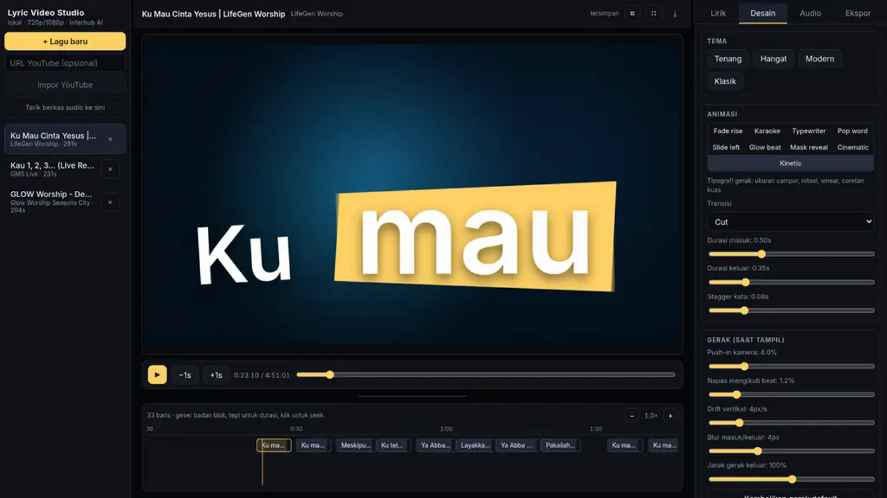

# Lyric Video Studio

Tool lokal untuk membuat **video lirik MP4** dari link YouTube atau berkas audio.

Dirancang untuk PC gereja berspesifikasi rendah: **tanpa AI lokal, tanpa Python,
tanpa Electron/Chromium tambahan**. Yang dibutuhkan hanya **Node + ffmpeg +
yt-dlp**. Transkripsi lirik memakai inferhub (cloud), BPM dianalisis di browser,
dan encoding video memakai WebCodecs di browser.




- Render 720p ±85 fps, 1080p ±40 fps (RTX 5050; PC gereja lebih lambat tapi tetap jalan)
- Lirik: YouTube auto-caption, LRC/VTT, LRCLIB, transkripsi AI, tap-sync manual
- 9 animasi + panel gerak + kinetic typography + grain film
- Panel & timeline bisa diatur lebarnya, responsif sampai layar ponsel

### Daftar isi

1. [Pasang prasyarat](#1-pasang-prasyarat) — Node, ffmpeg, yt-dlp
2. [Pasang aplikasi](#2-pasang-aplikasi) — clone + `npm install`
3. [Jalankan](#3-jalankan) — `start.bat` / `start.sh`
4. [Pindah ke PC gereja](#4-pindah-ke-pc-gereja) — apa yang disalin
5. [Konfigurasi `.env`](#5-konfigurasi-env)
6. [Cara pakai](#6-cara-pakai)
7. [Animasi](#7-animasi)
8. [Cara kerja AI](#8-cara-kerja-ai-inferhub)
9. [Struktur](#9-struktur)
10. [Uji](#10-uji)
11. [Kalau ada masalah](#11-kalau-ada-masalah)

---

## 1. Pasang prasyarat

### Windows (PC gereja)

Buka **PowerShell** (bukan cmd), lalu:

```powershell
winget install OpenJS.NodeJS.LTS
winget install Gyan.FFmpeg
winget install yt-dlp.yt-dlp
```

**Tutup dan buka lagi PowerShell** supaya PATH terbaca, lalu cek:

```powershell
node --version     # harus v22 atau lebih baru
ffmpeg -version
yt-dlp --version
```

Kalau `winget` tidak ada, pasang manual:

| Tool | Sumber | Catatan |
| --- | --- | --- |
| Node 22 LTS | https://nodejs.org/en/download | pilih installer `.msi` |
| ffmpeg | https://www.gyan.dev/ffmpeg/builds/ | ekstrak, tambahkan folder `bin` ke PATH |
| yt-dlp | https://github.com/yt-dlp/yt-dlp/releases | ambil `yt-dlp.exe`, taruh di folder yang ada di PATH |

### Linux

```bash
# Arch
sudo pacman -S nodejs npm ffmpeg yt-dlp

# Debian/Ubuntu
sudo apt install nodejs npm ffmpeg
sudo curl -L https://github.com/yt-dlp/yt-dlp/releases/latest/download/yt-dlp -o /usr/local/bin/yt-dlp
sudo chmod +x /usr/local/bin/yt-dlp
```

Pastikan `node --version` ≥ 22 (Debian/Ubuntu sering ketinggalan; pakai
[nvm](https://github.com/nvm-sh/nvm) kalau perlu).

### macOS

```bash
brew install node ffmpeg yt-dlp
```

---

## 2. Pasang aplikasi

```bash
git clone https://github.com/ZhayaGT/lyric-video-studio.git
cd lyric-video-studio
npm install
cp .env.example .env      # Windows: copy .env.example .env
```

Buka `.env` dengan Notepad / editor apa pun, isi kuncinya:

```ini
INFERHUB_API_KEY=sk-...isi-kunci-anda...
```

> **Tanpa kunci AI aplikasi tetap jalan penuh** — impor audio, LRC/manual,
> deteksi BPM, tap tempo, desain, dan ekspor MP4. Hanya tombol transkripsi AI
> dan "Rapikan teks" yang mati (UI menonaktifkannya otomatis).
> Kunci **tidak boleh** di-commit; `.env` sudah masuk `.gitignore`.

---

## 3. Jalankan

### Cara cepat (disarankan di PC gereja)

| OS | Aksi |
| --- | --- |
| Windows | klik dua kali **`start.bat`** |
| Linux / macOS | `./start.sh` |

Skrip itu otomatis `npm install` + `npm run build` bila belum ada, membuka
browser, lalu menjalankan server di **http://localhost:5178**.

### Manual

```bash
# mode produksi (satu port, paling ringan)
npm run build
npm start                 # http://localhost:5178

# mode development (hot reload, dua port)
npm run dev               # UI :5173, API :5178
```

Browser: **Chrome atau Edge** (butuh WebCodecs untuk encode H.264).

---

## 4. Pindah ke PC gereja

Yang **perlu** disalin:

```
src/  server/  tests/  package.json  package-lock.json
tsconfig.json  vite.config.ts  index.html
.env.example  start.bat  start.sh  README.md
```

Yang **tidak perlu** (buat ulang di sana):

```
node_modules/   dist/   .env
```

Yang **opsional** — salin kalau ingin lagu + lirik + hasil ekspor ikut pindah:

```
data/songs/     # project.json, audio, assets, exports per lagu
```

Langkah di PC gereja:

```powershell
# 1. salin folder proyek (flashdisk / git clone)
# 2. di folder proyek:
copy .env.example .env      # lalu isi INFERHUB_API_KEY
npm install
npm run build
start.bat
```

Kalau PC gereja tidak boleh akses internet sama sekali, lewati `.env` — semua
fitur offline tetap berfungsi kecuali impor YouTube, LRCLIB, dan AI.

---

## 5. Konfigurasi `.env`

| Variabel | Default | Keterangan |
| --- | --- | --- |
| `INFERHUB_API_KEY` | — | wajib untuk transkripsi AI |
| `INFERHUB_BASE_URL` | `https://api.inferhub.dev/v1` | endpoint OpenAI-compatible |
| `INFERHUB_AUDIO_MODEL` | `ali/qwen3.8-omni-flash` | model yang menerima `input_audio` |
| `INFERHUB_TEXT_MODEL` | `cb/deepseek-v4.1-flash` | dipakai "Rapikan teks" |
| `PORT` | `5178` | port server |

---

## 6. Cara pakai

1. **Impor** — tempel URL YouTube, atau tarik berkas audio ke panel kiri.
2. **Lirik** — impor LRC/VTT/teks, cari LRCLIB, atau **Transkripsi lirik (AI)**.
   Sunting baris, gabung/pisah, **Rapikan teks**, atau **Tap sync** + tombol `S`.
   Panel lirik otomatis mengikuti baris yang sedang dinyanyikan (tombol **Ikuti**).
3. **Desain** — tema, animasi, gerak, tipografi, warna, grain, tata letak.
4. **Audio** — deteksi BPM + grid beat (di browser), tap tempo, offset beat.
5. **Ekspor** — 720p/1080p, progress + ETA, batal, simpan frame PNG.
   Hasil di `data/songs/<id>/exports/`.

### Pintasan

| Tombol | Aksi |
| --- | --- |
| `Space` | play / pause |
| `←` / `→` | geser 0,1 s |
| `Shift` + `←` / `→` | geser 1 s |
| `S` | tap-sync baris terpilih |
| `Ctrl`/`Cmd` + `S` | simpan |
| `Esc` | tutup drawer / panel |

### Tata letak

- Lebar panel kiri/kanan dan tinggi timeline bisa digeser (splitter), tersimpan
  otomatis. Klik dua kali splitter untuk reset.
- Tombol **⛶** membuka pratinjau layar penuh.
- ≤1180 px: daftar lagu jadi drawer. ≤860 px: panel kanan jadi bottom sheet.

---

## 7. Animasi

Setiap baris punya tiga fase, semuanya fungsi murni dari `t` sehingga preview
dan ekspor identik frame-per-frame:

| Fase | Yang terjadi |
| --- | --- |
| **Masuk** | stagger per kata (khusus pop-word), fade + blur → tajam, naik dari bawah |
| **Tahan** | push-in kamera, napas mengikuti beat, drift vertikal |
| **Keluar** | fade linier + blur + gerak keluar dipercepat, stagger dibalik |

Preset: `fade-rise`, `karaoke`, `typewriter`, `pop-word`, `slide-left`,
`glow-beat`, `mask-reveal`, `cinematic`, `kinetic`.

**Kinetic** meniru lyric video komersial: kata ditampilkan beberapa sekaligus
dan raksasa, ukuran campur, coretan kuas di kata kunci, squash & stretch,
smear, dan punch kamera per beat. Semua parameternya ada di panel
**Tipografi gerak**.

---

## 8. Cara kerja AI (inferhub)

`server/lib/inferhub.ts` memecah lagu menjadi potongan MP3 90 detik (mono, 16 kHz,
64 kbps) lewat ffmpeg, mengirimnya **paralel 2 sekaligus** sebagai `input_audio`
ke `/chat/completions`, lalu menggabungkan hasilnya. Tiap potongan membawa
pre-roll 2 detik agar baris yang melintasi batas tetap utuh.

- Model harus multimodal audio; kalau tidak, API membalas `unsupported_modality`
  beserta daftar model yang mendukung.
- Balasan berbalut markdown tetap dibaca; potongan instrumental
  (`{"lines":[]}`) tidak dianggap gagal.
- Progress per potongan tampil di UI; job bisa dibatalkan.
- `POST /api/lyrics/polish` memperbaiki ejaan tanpa menyentuh timing.

---

## 9. Struktur

```
src/render/      renderFrame (satu sumber kebenaran preview + export), preset, kinetic, grain, export WebCodecs
src/audio/       analisis tempo + beat di browser (Web Audio)
src/lyrics/      parser LRC/VTT, pemecah teks, pengelompokan kata
src/ui/          React: library, preview, transport, timeline, panel
server/lib/      store, media Range, inferhub client, ffmpeg/yt-dlp helpers
server/routes/   songs, media, import, lyrics, jobs, mux, reveal
data/songs/<id>/ project.json, audio, assets/, exports/
```

---

## 10. Uji

```bash
npm test            # 55 tes: render, lirik, range, beat, inferhub, kinetic
npx tsc --noEmit    # typecheck
npm run build       # typecheck + bundling
```

---

## 11. Kalau ada masalah

| Gejala | Penyebab & solusi |
| --- | --- |
| `EADDRINUSE` | port 5178 dipakai proses lain — tutup instance lama, atau set `PORT` lain |
| `/api/health` → `ffmpeg:false` | ffmpeg tidak di PATH — buka ulang terminal setelah install |
| `ytdlp:false` | yt-dlp tidak di PATH |
| `inferhub.configured:false` | `.env` belum diisi / server belum di-restart |
| Tombol AI nonaktif | sama seperti di atas; fitur lain tetap jalan |
| Export: "Encoder creation error" | browser tanpa H.264 — otomatis fallback VP9; atau pakai Chrome/Edge |
| Export lambat | turunkan ke 720p; tutup tab lain |
| Impor YouTube gagal | YouTube memblokir/usia/429 — unggah berkas audio saja |
| LRCLIB kosong | normal untuk lagu Indonesia; pakai transkripsi AI |
| Audio tidak bisa di-seek | pastikan `/media/...` membalas `206` (lihat di bawah) |

Cek cepat:

```bash
curl -s localhost:5178/api/health
curl -sI -H "Range: bytes=0-1023" localhost:5178/media/songs/<id>/audio.m4a
```

---

## Lisensi

MIT — lihat [LICENSE](LICENSE).

Lirik lagu adalah hak cipta pemiliknya masing-masing. Tool ini hanya membantu
menyusun dan menganimasikan teks; pastikan Anda punya izin untuk
mendistribusikan video yang dihasilkan.
